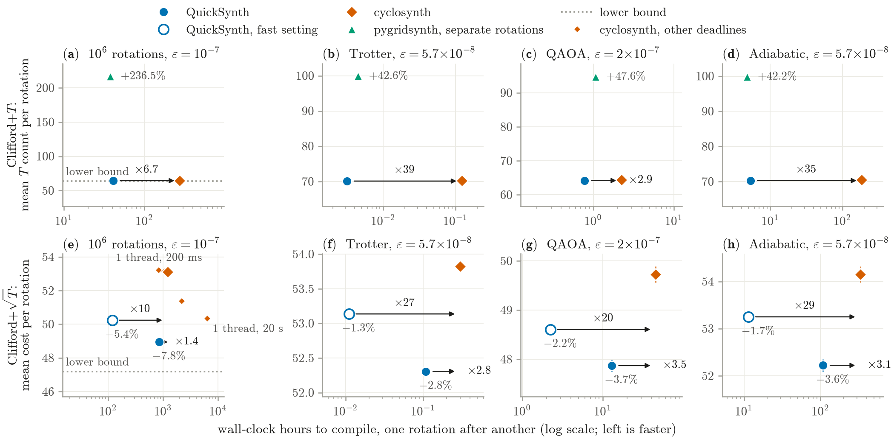
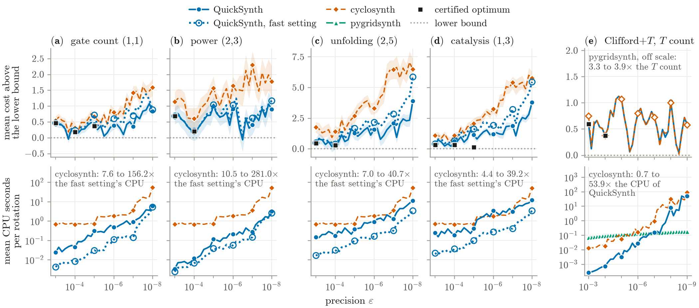
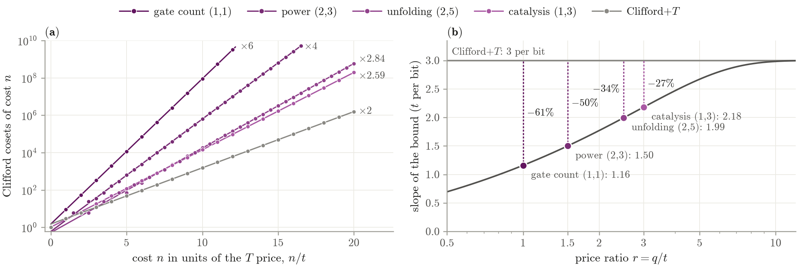

# Preliminary results

These figures come from the benchmark campaign behind the paper, which is
coming soon. The benchmark scripts and the raw records will be published in a
separate repository. Until then, the numbers below may still change. Each
figure is also available as a PDF (click the figure).

Every method runs on one thread per rotation. The prices `(t, q)` are the cost
of a `T` and of a `√T` magic state: gate count `(1,1)`, power `(2,3)`,
unfolding `(2,5)` and catalysis `(1,3)`.

## Cost against compile time

Mean cost per rotation against the wall-clock time to compile each workload,
with its rotations synthesised one after another. The top row is Clifford+T
priced by the T-count; the bottom row is Clifford+√T at the catalysis price.

* **(a), (e):** 106 Haar-random rotations at ε = 10-7,
  measured on 100 targets.
* **(b)–(d), (f)–(h):** three algorithm circuits (Trotter, QAOA and adiabatic
  evolution), compiled once per distinct rotation.

Filled circles are QuickSynth's default setting; open circles are its fast
setting. Arrows run from QuickSynth to cyclosynth's time at QuickSynth's
cost, labelled with the ratio of the times. The percentages compare each
method's cost with cyclosynth's at its default deadline; pygridsynth's are
compared with QuickSynth's.

At ε = 10-7 on Clifford+√T, the fast setting takes 0.43
CPU-seconds per rotation and the default 3.06. cyclosynth at its default
deadline takes 4.32, and its circuits cost 5.7% and 8.5% more. None of
cyclosynth's measured deadlines reaches the mean cost of either setting.

## Cost against precision

Mean cost above the lower bound (top) and mean CPU seconds per rotation
(bottom), against the precision ε = 10-3-j/6, over 40 Haar-random
targets.

* **(a)–(d):** Clifford+√T at the four prices, down to ε = 10-8,
  the lowest precision cyclosynth's Clifford+√T search supports.
* **(e):** Clifford+T priced by the T-count.

Black squares are the mean certified optimum of the same targets, where an
exhaustive search certifies all of them. The fast setting is faster than
cyclosynth at all 31 precisions at each of the four prices. At the catalysis
price it is also cheaper at each of them.

## Growth of the cost ball and the lower bound

**(a)** The number of Clifford cosets of each cost, for Clifford+√T at the four
prices and for Clifford+T priced by the T-count, labelled with the growth per
unit of the T price.

**(b)** The slope of the lower bound on the mean least cost of a Haar-random
target, in units of the T price per bit of precision, against the price ratio
r = q/t. The slope is 2.18 at the catalysis price, against 3 on Clifford+T.
